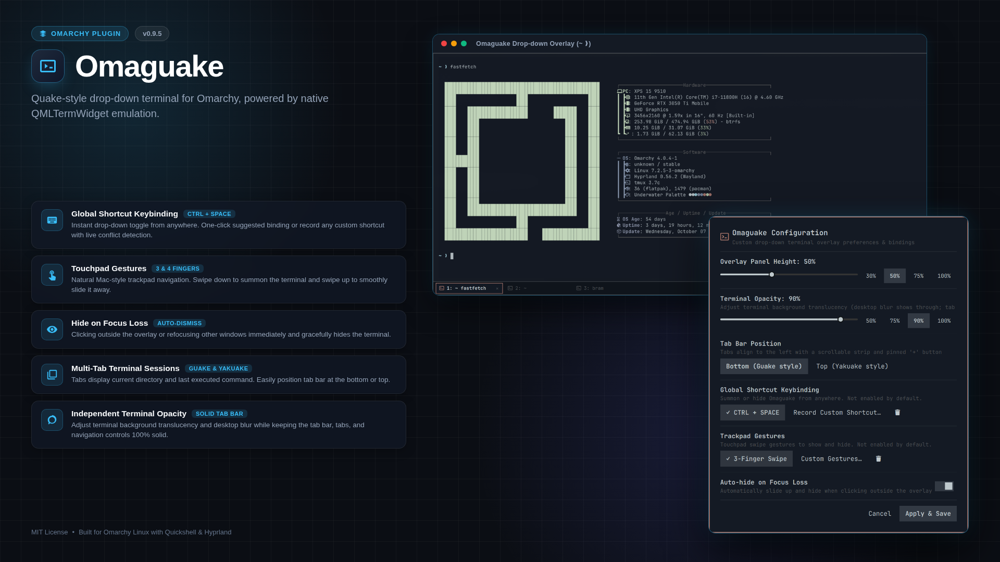

# OmaGuake

!!NO MANUAL SETUP REQUIRED !!

Just run...

```bash
omarchy plugin add https://github.com/bramvanoploo/omaguake.git --enable
```

... and the plugin will guide you if needed.


An [Omarchy](https://omarchy.org) status bar plugin and drop-down terminal mimicking **Guake** and **Yakuake**.



## Features

- **Dropdown Overlay**:
  - Full-width (100%), 50% screen height by default (configurable width and height from 20% to 100%).
  - Smooth animated slide-down on summon and slide-up on hide.
  - Background-only translucency with desktop blur while keeping terminal text 100% opaque and crisp.
  - Live Omarchy theme synchronization (background, foreground, cursor, and 16-color ANSI palette).
  - Automatically hides when focus is lost (clicking outside the terminal window).

- **Tabbed Layout & Process Persistence**:
  - Starts with one tab open by default running the user's default Omarchy shell/terminal.
  - Tabs align to the **left** with active command and directory indicators.
  - **Persistent Sessions**: Backed by `tmux` under an isolated socket; commands, jobs, and shell states remain alive and survive Quickshell restarts or crashes.
  - **Auto-Reattach**: Reopens and reconnects to all existing open tabs automatically when Quickshell reloads.
  - Tabs bar is horizontally scrollable to accommodate many open sessions.
  - Pinned **`+`** button on the far right of the tab bar to quickly open new tabs.
  - Tab close button (`×`) to terminate and close individual sessions cleanly.
  - Configurable tab bar position: **Bottom** (Guake style, default) or **Top** (Yakuake style).
  - Built-in keyboard shortcuts for tab management (`Ctrl+T`, `Ctrl+W`, `Ctrl+Tab`, `Ctrl+Shift+Tab`, `Ctrl+1..9`) and universal copy/paste (`Super+C`/`Super+V`, `Ctrl+Shift+C`/`Ctrl+Shift+V`, and active Hyprland universal clipboard bindings).

- **Summon Triggers**:
  - Global Keybinding: **`CTRL + SPACE`** suggested (or record any custom shortcut).
  - Trackpad Gestures:
    - **3-finger or 4-finger swipe down**: Show / summon terminal.
    - **3-finger or 4-finger swipe up**: Hide / dismiss terminal.
    - *Not enabled by default; configured with conflict checking via the settings overlay.*

- **Smart Conflict Validation & Resolution**:
  - When configuring keybindings, OmaGuake checks against active Hyprland bindings and Omarchy shortcuts.
  - If a conflict is detected, OmaGuake alerts you with the conflicting action, offers conflict-free alternatives, or lets you take ownership automatically.
  - Trackpad gestures are checked against existing gestures and 3-finger drag (`drag_3fg`) configurations.

- **Status Bar Integration**:
  - Status bar widget with terminal icon.
  - **Left-click**: Toggle OmaGuake dropdown terminal (automatically checks for `qmltermwidget` and offers a one-click installation dialog if missing).
  - **Right-click**: Open the plugin configuration overlay.

## Installation

```bash
omarchy plugin add https://github.com/bramvanoploo/omaguake.git --enable
```

> [!NOTE]
> - `qmltermwidget` (from the official `extra` repository) is required to render terminals inside the Quickshell overlay. If it is not yet installed, clicking the OmaGuake bar icon will prompt to install it automatically.
> - `tmux` is recommended to enable background session persistence and auto-restoration across shell restarts. If `tmux` is not present, OmaGuake automatically falls back to running `$SHELL` directly.

## Uninstall

1. Remove the plugin

```bash
omarchy plugin remove bramvanoploo.omaguake
```

2. Remove the custom bindings from `~/.config/hypr/bindings.lua`
```lua
-- BEGIN bramvanoploo.omaguake
....
-- END bramvanoploo.omaguake
```

## Configuration

Right-click the OmaGuake bar icon (or click `⚙` in the terminal tab bar) to open the configuration overlay (all changes apply immediately in real time):
- **Interface Language**: Follow system locale or choose from 15+ supported languages.
- **Height**: Adjust dropdown panel height (20% – 100%, in 5% increments).
- **Width**: Adjust dropdown panel width (20% – 100%, default 100%, in 5% increments), centered horizontally.
- **Opacity**: Adjust terminal background opacity (20% – 100%, in 5% increments) while keeping terminal text and the tab bar 100% opaque.
- **Tabs Position**: Choose between Bottom (Guake) or Top (Yakuake).
- **Keybinding**: Apply the suggested shortcut (`CTRL + SPACE`) or record any custom key chord with automatic conflict resolution.
- **Trackpad Gestures**: Configure 3-finger or 4-finger vertical swipe gestures with conflict checking.
- **Auto-hide**: Toggle auto-hide on focus loss.

## Architecture & Third-Party Dependencies

### [QMLTermWidget](https://github.com/Swordfish90/qmltermwidget)
- **License**: [GPL-2.0](https://github.com/Swordfish90/qmltermwidget/blob/master/LICENSE)
- **How it is used**: OmaGuake uses `qmltermwidget` from the official repositories (`extra`) to provide native hardware-accelerated terminal emulation directly inside the Quickshell Qt overlay. It handles PTY allocation, font glyph rendering, VT100/ANSI sequences, selection, and clipboard integration. The plugin automatically checks for this dependency on first launch and offers one-click automatic installation via `yay` (or `pacman`).

### [tmux](https://github.com/tmux/tmux) (Session Backend)
- **License**: ISC / BSD
- **How it is used**: OmaGuake manages background sessions using an isolated `tmux` socket (`-L omaguake`) with its status bar strictly disabled (`status off`). This preserves running commands, buffers, and tab states across desktop shell crashes and restarts, automatically reconnecting them upon startup.

## License

MIT © Bram van Oploo
